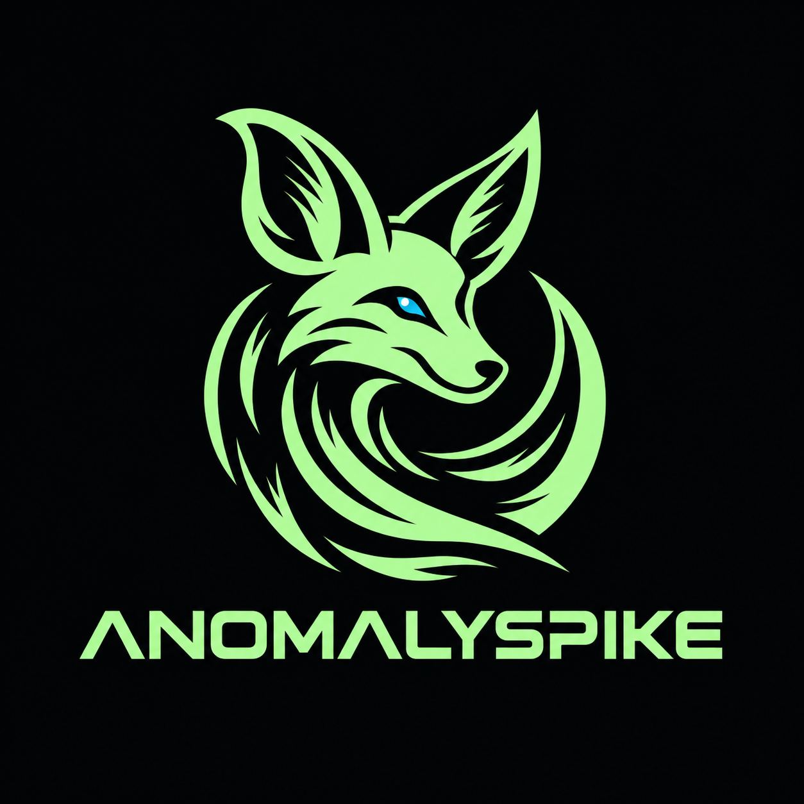

<div align="center">
  
  <h1>AnomalySpike</h1>
  <p><strong>AI-assisted network security monitoring and anomaly investigation.</strong></p>
  <p><a href="https://github.com/TakieddineLom/AnomalySpike">Repository</a> · Thirduni programme · Research and development prototype</p>
</div>

---

AnomalySpike is a team-built cybersecurity prototype developed during the Thirduni programme. It brings together network telemetry, intrusion-detection alerts, machine-learning-based anomaly detection, and retrieval-based security knowledge to help small IT and security teams investigate potentially suspicious network activity.

> **Project status:** Prototype. Detection coverage, operational reliability, and performance require further evaluation. Some components use test data, as noted below.

## Contents

- [The problem](#the-problem)
- [Features](#features)
- [Architecture](#architecture)
- [Web console](#web-console)
- [Technology stack](#technology-stack)
- [Requirements and setup](#requirements)
- [Development checks](#development-checks)
- [Known limitations](#known-limitations)
- [Team contributions](#team-contributions)
- [Project information](#project-information)

## The problem

Security teams often need to move between network logs, IDS alerts, and reference documentation to understand suspicious activity. Smaller teams may not have the resources for complex commercial monitoring platforms.

AnomalySpike explores how open-source network sensors, a searchable event store, anomaly scoring, and security knowledge retrieval can make this investigation workflow more accessible.

## Features

- **Network telemetry:** Collects and indexes events produced by Zeek.
- **IDS alerts:** Ingests Suricata alerts for review in the web console.
- **Anomaly detection:** Aggregates network activity into host-behaviour feature windows and scores them with the project's detection pipeline.
- **Security knowledge search:** Retrieves relevant information from a small security knowledge base, including MITRE ATT&CK and network-behaviour notes.
- **Host investigation:** Provides views for reviewing hosts and their observed activity.
- **Web console:** Dashboard, alerts, connections, DNS analysis, threat detection, hosts, and interface settings.
- **Interface selection:** Lets an operator select the interface recorded in the monitoring configuration. Sensor services may need to be restarted before the selection takes effect.

## Architecture

```text
              Network traffic
                /         \
             Zeek        Suricata
               |             |
         Zeek collectors   Alert collector
               |             |
               +------v------+
                      |
                  OpenSearch
                      |
                 FastAPI API
                      |
                 Web console

       Events -> Feature aggregation -> Anomaly scoring
                                            |
                                  Anomaly index / UI

       Security knowledge -> Retrieval search -> Investigation context
```

### Data flow

1. Zeek provides network telemetry, while Suricata produces intrusion-detection alerts.
2. Collector processes normalize selected sensor output and index it in OpenSearch.
3. Feature aggregation builds host-behaviour windows from observed events.
4. The detection pipeline scores feature windows and stores flagged anomalies.
5. FastAPI exposes API endpoints and serves the browser-based console.
6. The retrieval-based knowledge component searches a small security reference collection to provide additional investigation context.

The actual data sources and collection behaviour vary by component. See [Known limitations](#known-limitations) before interpreting the output as a complete live security-monitoring system.

## Web console

| Page | Route | Purpose |
|---|---|---|
| Dashboard | `/dashboard` | Overview of monitoring activity |
| Suricata alerts | `/alerts` | Review indexed IDS alerts |
| Connections | `/connections` | Inspect indexed Zeek connection events |
| DNS analysis | `/dns` | Review DNS data; currently uses a static test file |
| Threat detection | `/threats` | Review detected anomalies and related knowledge |
| Connected hosts | `/hosts` | Inspect hosts observed in indexed events |
| Settings | `/settings` | Select the monitored network interface |

The application also exposes API endpoints, including `/api/status`, `/api/health`, `/api/events`, `/api/interfaces`, and `/api/knowledge/search`. The exact response and data availability depend on the running services and indexed data.

## Technology stack

- **Language:** Python, HTML, CSS, JavaScript
- **API and web server:** FastAPI, Uvicorn
- **Search and event storage:** OpenSearch
- **Network visibility:** Zeek
- **Intrusion detection:** Suricata
- **Machine learning and numerical processing:** scikit-learn, PyOD, NumPy, SciPy, joblib
- **Knowledge retrieval and embeddings:** sentence-transformers, PyTorch
- **Tool integration:** Model Context Protocol (MCP)
- **Deployment components:** Ubuntu/Linux, Docker Compose, systemd, cron

## Requirements

The current development deployment uses Ubuntu, Python, Docker with Docker Compose, OpenSearch, Zeek, and Suricata.

Python dependencies are pinned in `backend/requirements.txt`.

The repository's current deployment configuration is tailored to the development environment. In particular, the backend uses a fixed configuration path under `/home/taki/AnomalySpike`. A fresh installation on another machine will require configuration changes and validation.

## Running the web application

These steps start the API and web console after the required services and configuration are available. They do **not** install or configure Zeek, Suricata, collectors, scheduled feature processing, or OpenSearch automatically.

### 1. Clone the repository

```bash
git clone https://github.com/TakieddineLom/AnomalySpike.git
cd AnomalySpike
```

### 2. Create a Python environment

```bash
python3 -m venv .venv
source .venv/bin/activate
python -m pip install --upgrade pip
python -m pip install -r backend/requirements.txt
```

Use a Python version compatible with the pinned dependencies. Dependency installation should be tested on the target machine before using this procedure as a production deployment guide.

### 3. Configure supporting services

Before launching the application:

- Start OpenSearch and confirm that it is reachable at `http://localhost:9200`.
- Configure and start Zeek and Suricata if live sensor data is required.
- Configure the collectors and scheduled feature/detection jobs.
- Create the local monitoring configuration expected by the backend.
- Confirm that the required OpenSearch indices and knowledge-retrieval assets are available.

The included `docker-compose.yml` configures OpenSearch with its security plugin disabled for development. Do not expose that configuration directly to an untrusted network. A public deployment needs an appropriately secured search service, access controls, network restrictions, and deployment-specific configuration.

### 4. Start FastAPI

From the repository root:

```bash
source .venv/bin/activate
python -m uvicorn backend.app.main:app --host 127.0.0.1 --port 8000
```

Open `http://127.0.0.1:8000` in a browser on the same machine.

For access from another machine, configure a protected deployment and network access deliberately rather than exposing a development instance by default.

### 5. Check application status

Open these endpoints in a browser:

- `http://127.0.0.1:8000/api/status`
- `http://127.0.0.1:8000/api/health`

The health endpoint checks the connection to OpenSearch. A healthy API response does not, by itself, prove that all sensors, collectors, scheduled jobs, or data sources are working.

## Existing development service operations

The development machine uses systemd for several services. These names apply only if the corresponding service units have been installed:

```bash
sudo systemctl status \
  anomalyspike-backend \
  anomalyspike-zeek \
  anomalyspike-zeek-collector \
  anomalyspike-zeek-dns-collector \
  anomalyspike-suricata-collector \
  --no-pager
```

To inspect scheduled jobs and application logs:

```bash
crontab -l
tail -n 50 logs/features.log
tail -n 50 logs/detection.log
```

Use the service manager to control managed processes. Avoid starting duplicate sensor or collector processes manually alongside services already managed by systemd or cron.

## Development checks

From the repository root:

```bash
source .venv/bin/activate
python -m py_compile backend/app/main.py
node --check frontend/renderer.js
```

These commands check Python syntax and JavaScript syntax; they do not test the full monitoring pipeline.

## Known limitations

- **DNS data:** The DNS collector currently reads a static test file rather than the live Zeek DNS log. The DNS page must not be presented as live DNS monitoring until this is corrected and verified.
- **Suricata ingestion:** The collector may not backfill alerts generated during a crash or restart window.
- **Knowledge coverage:** The retrieval knowledge base is small. Search results are supporting context, not proof that a security event is malicious.
- **Detection validation:** Anomaly scores and flags need evaluation against repeatable benign and suspicious traffic scenarios. An anomaly is not automatically a confirmed attack.
- **Deployment portability:** The current backend includes a machine-specific monitoring configuration path.
- **Operational readiness:** The prototype requires further validation of installation, service recovery, access controls, and sustained operation before production use.
- **Automated response:** Do not assume that blocking, quarantine, or other automated enforcement is implemented unless it is demonstrated and documented in the submitted version.

## Team contributions

Replace the placeholders before submission. Describe the work each person actually completed.

- **[Team member 1 — full name]:** [Specific contribution to implementation, testing, research, design, or documentation.]
- **[Team member 2 — full name]:** [Specific contribution.]
- **[Team member 3 — full name]:** [Specific contribution.]

Add or remove entries to match the actual team.

## AI tools and external resources

Complete this section accurately before submission. List the AI tools used during development and explain briefly how they supported the work. Also acknowledge significant external libraries, frameworks, and references where appropriate. Do not claim a tool was used unless it was.

## Next three months

Our next priority is to make AnomalySpike easier to install and evaluate, validate its detection pipeline against repeatable benign and suspicious traffic scenarios, and improve the analyst investigation workflow. We plan to document model limitations and test results, strengthen deployment and security guidance, and explore safe, human-approved response integration. The goal is a reproducible prototype that small IT and security teams can evaluate, rather than adding features without validation.

## Project information

- **Programme:** Thirduni
- **Project:** AnomalySpike
- **Repository:** https://github.com/TakieddineLom/AnomalySpike
- **Status:** Research and development prototype
